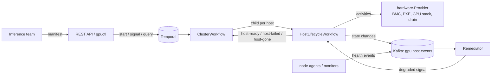
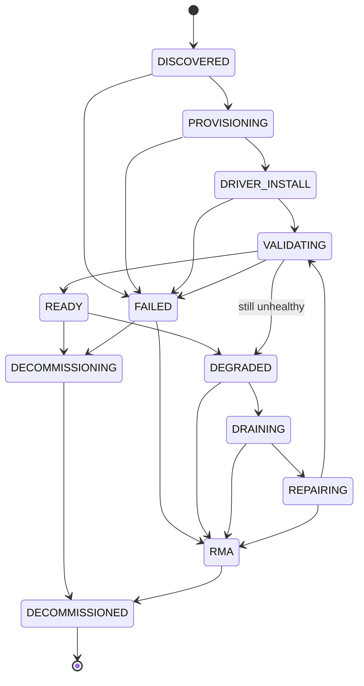

# Architecture

## Components

## Host state machine

The transition table lives in `internal/domain` and is the single source of truth. `Host.Transition` rejects illegal edges, increments a version and records history. `SchemaVersion` identifies the table, and `workflow.GetVersion` guards logic changes for in-flight workflows.

## Key design decisions

**The workflow is the state machine.** Host state lives in workflow history rather than a database, so it survives worker crashes and resumes mid-step. It is exposed through a query handler, and every change is published as an event for observability.

**Deterministic core, thin Temporal layer.** Everything with side effects is an activity (plain Go methods, no SDK import), and the state machine is pure. This keeps the logic unit-testable without Temporal and keeps workflow code deterministic (`workflow.Now`, durable timers, ordered slices instead of map iteration).

**Idempotency everywhere.** Each `hardware.Provider` call is safe to repeat. `Reserve` is keyed by cluster and batch so a retried reservation returns the same hosts. State-change event IDs are `hostID:version` so at-least-once delivery can be de-duplicated.

**Transient vs permanent failures.** Transient errors retry with exponential backoff. A `*PermanentError` is declared non-retryable in the retry policy by its type name (`PermanentError`, asserted in a test) and routes the host to RMA instead of looping.

**Compensation.** A failed bring-up runs on a disconnected context so cleanup still happens if the workflow is cancelled: drain, power off, wipe, open an RMA ticket if the fault is permanent, move to `RMA`/`DECOMMISSIONED`, and tell the parent cluster.

**Event-driven self-healing.** A `host.health.degraded` event is turned into a `degraded` signal by the remediator. The workflow then runs: `DEGRADED → DRAINING → REPAIRING → VALIDATING → READY`. Repair always reconverges the GPU stack to the desired driver/CUDA version, so repair and drift correction are the same mechanism. Bursts of duplicate signals collapse into one remediation.

**Drift detection without cron.** A READY host waits on signals and a durable 15-minute timer. When the timer fires, observed state (driver, CUDA, GPU count, power) is compared with the manifest and any drift triggers remediation.

**Cluster-level healing.** `ClusterWorkflow` starts one child host workflow per host and waits on `host-ready` / `host-failed` / `host-gone` signals rather than polling. A failed host is replaced automatically, up to a bounded budget, after which the cluster reports `Degraded`.

**Bounded history.** Host workflows `ContinueAsNew` after 50 loop iterations, carrying the host record forward. History inside the record is capped.

## Declarative API semantics

- The cluster workflow ID is `cluster-<name>`, so `POST` of the same manifest twice cannot start two clusters.
- `PUT` only accepts a change to `spec.gpus`; other changes are rejected as immutable, which avoids hidden destructive reconfiguration.
- `GET` reads status via a Temporal query, so the API holds no state of its own and can be scaled horizontally.

## Extending to real hardware

Implement `hardware.Provider` against Redfish/IPMI (power, boot device), an iPXE/image service (OS install), node agents (driver/CUDA, DCGM, NCCL tests) and the Kubernetes API (cordon, drain). Replace `hardware.NewSimulator()` in `cmd/worker/main.go`. Nothing else changes.
